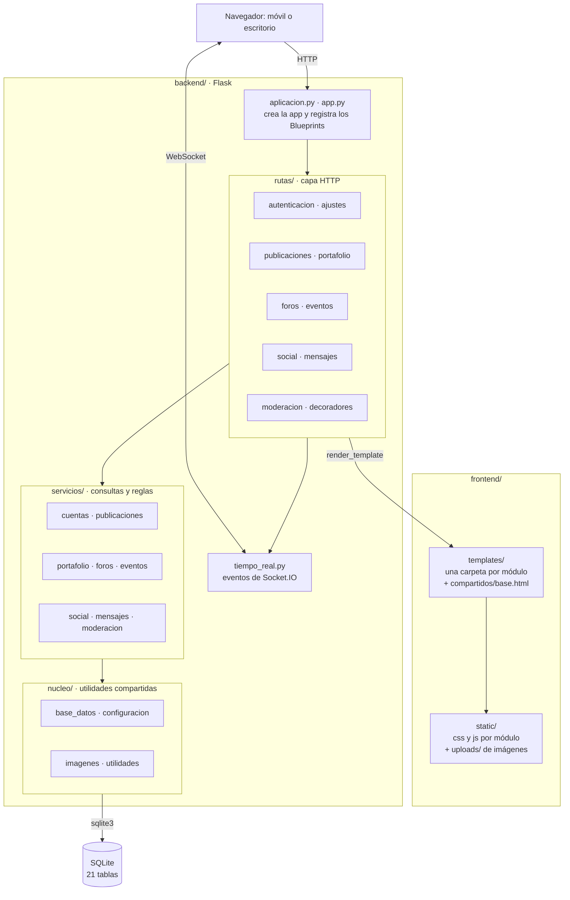

# Arquitectura y paquetes

Es una aplicación web en Python con Flask, sin base de datos externa (SQLite en `data/agora.db`), con mensajería en tiempo real por Socket.IO. El navegador recibe páginas HTML generadas con Jinja2 y archivos estáticos (CSS y JS) organizados por módulo.

## Cosas que tener en cuenta
- Cada módulo funcional tiene un Blueprint en `backend/rutas/`, un servicio en `backend/servicios/` (con las consultas SQL) y su carpeta en `frontend/templates/` y `frontend/static/`. Así se agrega un módulo sin tocar el núcleo (RNF-05).
- La configuración viene de variables de entorno (`SECRET_KEY`, `DATABASE_PATH`, `FLASK_DEBUG`); la aplicación no lee el archivo `.env` por sí sola.
- Las imágenes subidas se validan, se vuelven a codificar con Pillow y se guardan en `frontend/static/uploads/` (que Git ignora).
- Los roles son estudiante, moderador y administrador (columna `usuarios.rol`). `before_request` expulsa las sesiones de cuentas suspendidas.
- Los tests (`tests/`) y el workflow de CI (`.github/workflows/tests.yml`) corren con `unittest`.
