# Casos de uso por módulo

Mermaid no tiene diagrama UML de casos de uso, así que lo dibujamos como un mapa de qué casos de uso usa cada actor. El detalle original (descripciones y flujos) está en `docs/legacy/Diagramas_ICONIX.drawio`; este mapa sale de sus casos de uso (páginas CU).

Los actores son el estudiante (usuario registrado), el moderador y el administrador. El moderador y el administrador también pueden hacer lo que hace el estudiante, y el administrador puede hacer lo del moderador (en el código, `moderador_required` deja pasar a ambos roles).

Los casos de uso con **borde punteado** son los que todavía no funcionan en `main`: no existen o fallan. El estado de cada requerimiento está en [`docs/requerimientos/funcionales.md`](../requerimientos/funcionales.md).

```mermaid
flowchart LR
    E([Estudiante])
    M([Moderador])
    A([Administrador])

    subgraph M1[Autenticación]
        direction TB
        U11[Registrar cuenta]
        U12[Iniciar y cerrar sesión]
        U13[Verificar cuenta]
        U14[Recuperar contraseña]
    end
    subgraph M2[Feed]
        direction TB
        U21[Consultar feed]
        U22[Crear publicación]
        U23[Editar o eliminar publicación]
        U24[Reaccionar y comentar]
        U25[Hashtags y visibilidad]
    end
    subgraph M3[Perfil y portafolio]
        direction TB
        U31[Consultar perfil]
        U32[Seguir y ver seguidores]
        U33[Crear proyecto y aplaudir]
        U34[Ver, editar o comentar proyecto]
    end
    subgraph M4[Foros]
        direction TB
        U41[Consultar foro]
        U42[Crear pregunta]
        U43[Responder, votar y aceptar]
        U44[Suscribirse a foro]
    end
    subgraph M5[Explorar]
        direction TB
        U51[Buscar publicaciones, personas y foros]
        U52[Buscar proyectos]
        U53[Ver tendencias]
    end
    subgraph M6[Ajustes y ayuda]
        direction TB
        U61[Modificar perfil]
        U62[Cambiar correo y contraseña]
        U63[Privacidad, notificaciones, apariencia e idioma]
        U64[Ayuda y soporte]
    end
    subgraph M7[Eventos]
        direction TB
        U71[Consultar eventos]
        U72[Crear evento]
        U73[Editar evento]
        U74[Eliminar evento]
        U75[Inscribirse o cancelar]
        U76[Ver participantes]
    end
    subgraph M8[Reportes]
        direction TB
        U81[Reportar publicación, comentario o usuario]
        U82[Consultar estado de mis reportes]
    end
    subgraph M9[Moderación]
        direction TB
        U91[Revisar reportes]
        U92[Resolver reporte]
        U93[Aprobar publicaciones y levantar sanciones]
    end
    subgraph M10[Administración]
        direction TB
        U101[Ver panel y estadísticas]
        U102[Gestionar usuarios]
        U103[Gestionar foros]
    end
    subgraph M11[Notificaciones]
        direction TB
        U111[Consultar y marcar como leídas]
        U112[Eliminar notificación]
    end
    subgraph M12[Mensajería]
        direction TB
        U121[Consultar y archivar conversaciones]
        U122[Chatear en tiempo real]
    end

    E --> U11 & U12 & U13 & U14 & U21 & U22 & U23 & U24 & U25
    E --> U31 & U32 & U33 & U34 & U41 & U42 & U43 & U44
    E --> U51 & U52 & U53 & U61 & U62 & U63 & U64
    E --> U71 & U72 & U73 & U74 & U75 & U76 & U81 & U82
    E --> U111 & U112 & U121 & U122
    M --> U91 & U92 & U93
    A --> U101 & U102 & U103

    classDef pendiente stroke-dasharray: 5 5
    class U13,U14,U25,U34,U44,U52,U53,U63,U81,U82,U93,U101,U102,U103,U112 pendiente
```

