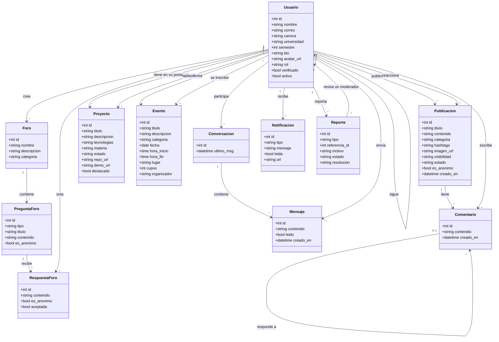

# Diagrama de clases del dominio

Parte de las entidades del diagrama de dominio del documento original (`docs/legacy/Diagramas_ICONIX.drawio`) y del modelo de datos. Los atributos son los de `scripts/esquema.sql`. El código de Agora no define clases de dominio: usa funciones de servicio sobre SQLite, así que este diagrama es conceptual.

## Cosas que tener en cuenta
- `Hashtag` y `Perfil` aparecen en el diagrama de dominio original, pero no existen como entidades en el código: los hashtags son una columna de `publicaciones` que todavía no se usa y el perfil son los campos de `usuarios`.
- Un `Reporte` apunta a una publicación, un comentario o un usuario según su `tipo` (`referencia_id`), por eso no se dibuja como una asociación fija.
- Los comentarios de proyectos (`comentarios_proyecto`) y las publicaciones guardadas (`guardados`) existen en la base de datos, pero el código no los usa todavía.
