# Modelo entidad-relación

Sale de `scripts/esquema.sql` (21 tablas, SQLite). Si la base de datos cambia, este diagrama y el SQL se actualizan juntos en el mismo PR.

```mermaid
erDiagram
    USUARIOS ||--o{ SEGUIDORES : "seguidor_id"
    USUARIOS ||--o{ SEGUIDORES : "seguido_id"
    USUARIOS ||--o{ PUBLICACIONES : "autor_id"
    USUARIOS ||--o{ REACCIONES_PUBLICACION : "usuario_id"
    PUBLICACIONES ||--o{ REACCIONES_PUBLICACION : "publicacion_id"
    PUBLICACIONES ||--o{ COMENTARIOS : "publicacion_id"
    USUARIOS ||--o{ COMENTARIOS : "autor_id"
    COMENTARIOS |o--o{ COMENTARIOS : "padre_id"
    USUARIOS ||--o{ REACCIONES_COMENTARIO : "usuario_id"
    COMENTARIOS ||--o{ REACCIONES_COMENTARIO : "comentario_id"
    USUARIOS |o--o{ FOROS : "creado_por"
    FOROS ||--o{ PREGUNTAS_FORO : "foro_id"
    USUARIOS |o--o{ PREGUNTAS_FORO : "autor_id"
    PREGUNTAS_FORO ||--o{ RESPUESTAS_FORO : "pregunta_id"
    USUARIOS |o--o{ RESPUESTAS_FORO : "autor_id"
    USUARIOS ||--o{ VOTOS_RESPUESTA : "usuario_id"
    RESPUESTAS_FORO ||--o{ VOTOS_RESPUESTA : "respuesta_id"
    USUARIOS ||--o{ PROYECTOS : "autor_id"
    USUARIOS ||--o{ APLAUSOS_PROYECTO : "usuario_id"
    PROYECTOS ||--o{ APLAUSOS_PROYECTO : "proyecto_id"
    PROYECTOS ||--o{ COMENTARIOS_PROYECTO : "proyecto_id"
    USUARIOS ||--o{ COMENTARIOS_PROYECTO : "autor_id"
    USUARIOS ||--o{ EVENTOS : "creador_id"
    USUARIOS ||--o{ INSCRIPCIONES_EVENTO : "usuario_id"
    EVENTOS ||--o{ INSCRIPCIONES_EVENTO : "evento_id"
    CONVERSACIONES ||--o{ PARTICIPANTES_CONVERSACION : "conversacion_id"
    USUARIOS ||--o{ PARTICIPANTES_CONVERSACION : "usuario_id"
    CONVERSACIONES ||--o{ MENSAJES : "conversacion_id"
    USUARIOS ||--o{ MENSAJES : "autor_id"
    USUARIOS ||--o{ NOTIFICACIONES : "usuario_id"
    USUARIOS ||--o{ REPORTES : "reportado_por"
    USUARIOS |o--o{ REPORTES : "revisado_por"
    USUARIOS ||--o{ GUARDADOS : "usuario_id"
    PUBLICACIONES ||--o{ GUARDADOS : "publicacion_id"

    USUARIOS {
        int id PK
        string nombre
        string correo UK
        string password
        string carrera
        string universidad
        int semestre
        string bio
        string avatar_url
        string rol "estudiante, moderador, admin"
        int verificado
        int activo
        datetime creado_en
    }
    SEGUIDORES {
        int seguidor_id PK, FK
        int seguido_id PK, FK
        datetime creado_en
    }
    PUBLICACIONES {
        int id PK
        int autor_id FK
        string titulo
        string contenido
        string categoria "academico, meme, foro, portafolio, general"
        string hashtags
        string imagen_url
        string visibilidad "todos, seguidores, carrera"
        string estado "publicado, borrador, eliminado, pendiente"
        int es_anonimo
        datetime creado_en
        datetime editado_en
    }
    REACCIONES_PUBLICACION {
        int usuario_id PK, FK
        int publicacion_id PK, FK
        string tipo "aplauso, craneo, manos, estrella"
        datetime creado_en
    }
    COMENTARIOS {
        int id PK
        int publicacion_id FK
        int autor_id FK
        string contenido
        int padre_id FK
        datetime creado_en
    }
    REACCIONES_COMENTARIO {
        int usuario_id PK, FK
        int comentario_id PK, FK
        datetime creado_en
    }
    FOROS {
        int id PK
        string nombre UK
        string descripcion
        string categoria
        int creado_por FK
        datetime creado_en
    }
    PREGUNTAS_FORO {
        int id PK
        int foro_id FK
        int autor_id FK
        string tipo "pregunta, apuntes, duda, recurso, debate"
        string titulo
        string contenido
        int es_anonimo
        datetime creado_en
    }
    RESPUESTAS_FORO {
        int id PK
        int pregunta_id FK
        int autor_id FK
        string contenido
        int es_anonimo
        int aceptada
        datetime creado_en
    }
    VOTOS_RESPUESTA {
        int usuario_id PK, FK
        int respuesta_id PK, FK
        int valor
        datetime creado_en
    }
    PROYECTOS {
        int id PK
        int autor_id FK
        string titulo
        string descripcion
        string tecnologias
        string materia
        string estado "en_desarrollo, completado, pausado"
        date fecha_inicio
        date fecha_fin
        string imagen_url
        string repo_url
        string demo_url
        int destacado
        datetime creado_en
    }
    APLAUSOS_PROYECTO {
        int usuario_id PK, FK
        int proyecto_id PK, FK
        datetime creado_en
    }
    COMENTARIOS_PROYECTO {
        int id PK
        int proyecto_id FK
        int autor_id FK
        string contenido
        datetime creado_en
    }
    EVENTOS {
        int id PK
        int creador_id FK
        string titulo
        string descripcion
        string categoria "academico, cultural, deportivo, bienestar"
        date fecha
        time hora_inicio
        time hora_fin
        string lugar
        int cupos
        string organizador
        string agenda
        datetime creado_en
    }
    INSCRIPCIONES_EVENTO {
        int usuario_id PK, FK
        int evento_id PK, FK
        datetime creado_en
    }
    CONVERSACIONES {
        int id PK
        datetime creado_en
        datetime ultimo_msg
    }
    PARTICIPANTES_CONVERSACION {
        int conversacion_id PK, FK
        int usuario_id PK, FK
        int archivada
    }
    MENSAJES {
        int id PK
        int conversacion_id FK
        int autor_id FK
        string contenido
        int leido
        datetime creado_en
    }
    NOTIFICACIONES {
        int id PK
        int usuario_id FK
        string tipo "like, comentario, seguidor, mencion, foro, proyecto, evento, reporte"
        string mensaje
        int leida
        string url
        datetime creado_en
    }
    REPORTES {
        int id PK
        int reportado_por FK
        string tipo "publicacion, comentario, usuario"
        int referencia_id
        string motivo
        string descripcion
        string estado "enviado, en_revision, resuelto, descartado"
        int revisado_por FK
        string resolucion
        datetime creado_en
        datetime resuelto_en
    }
    GUARDADOS {
        int usuario_id PK, FK
        int publicacion_id PK, FK
        datetime creado_en
    }
```

## Cosas que tener en cuenta
- Las columnas `publicaciones.hashtags` y `publicaciones.visibilidad` existen en la base de datos, pero el código todavía no las usa (RF-10).
- La tabla `guardados` (publicaciones guardadas) existe en el esquema, pero el código no la usa todavía.
- `usuarios.verificado` tampoco tiene un flujo que lo cambie (RF-03).
- Los reportes (`reportes.referencia_id`) apuntan a una publicación, un comentario o un usuario según `reportes.tipo`, así que esa relación no la puede forzar la base de datos y no aparece como línea en el diagrama.
- `ON DELETE CASCADE` está en casi todas las claves foráneas: borrar un usuario borra también sus publicaciones, comentarios, mensajes y reacciones.
