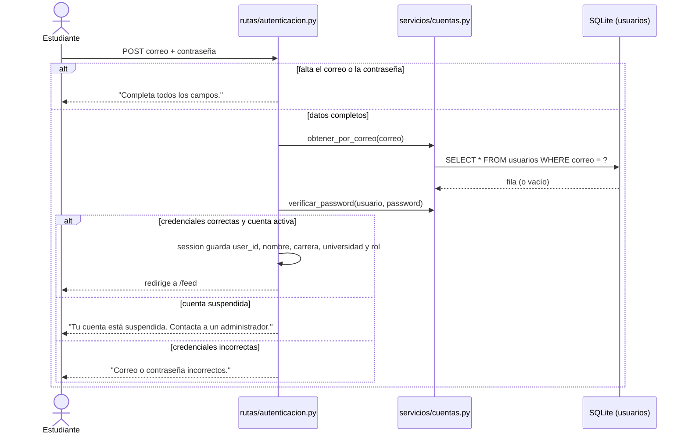
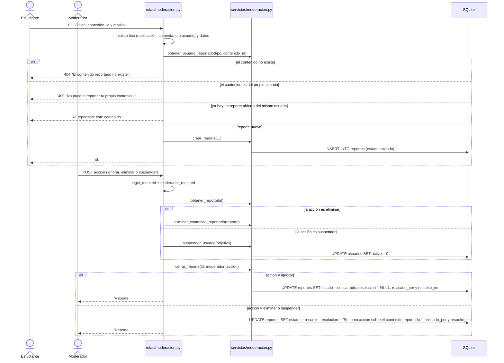
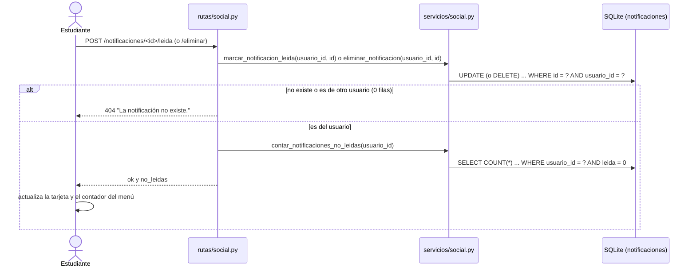
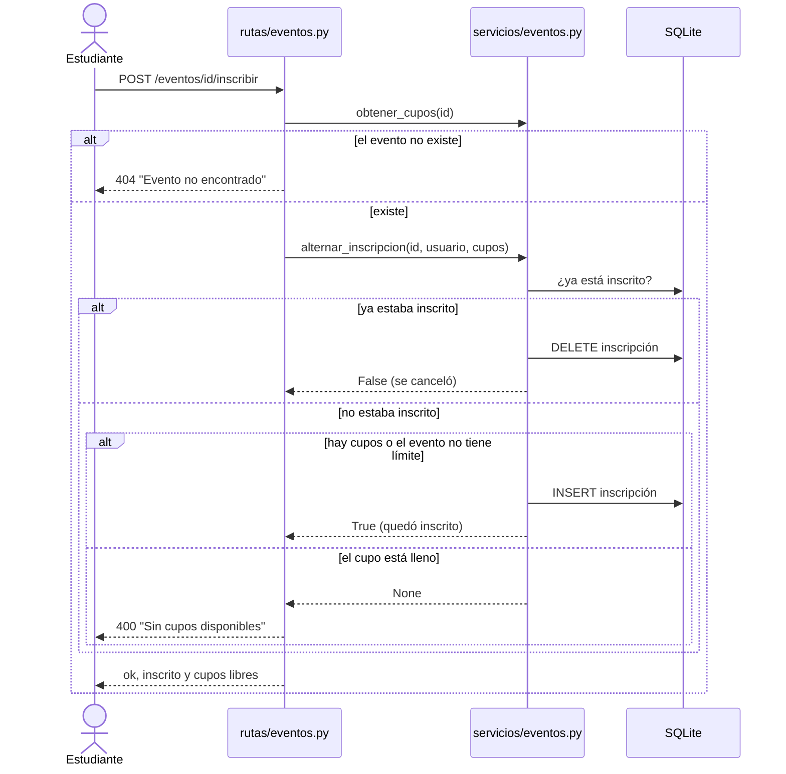
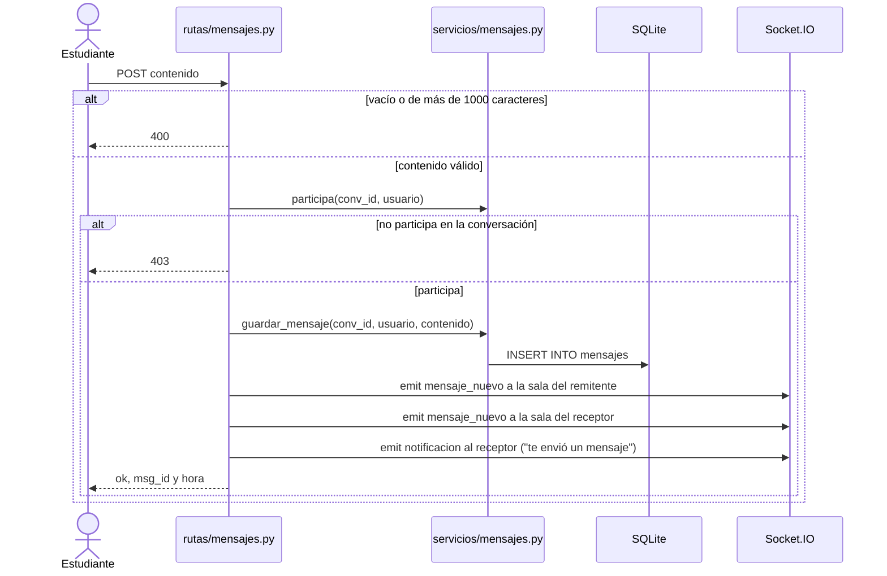

# Diagramas de secuencia

## Iniciar sesión (RF-02): `POST /login`

## Reportar y resolver un reporte (RF-32 y RF-35): `POST /reporte/nuevo` y `POST /moderacion/resolver/<id>`

Desde el detalle de una publicación, el botón «⚑ Reportar» abre un modal y llama a `/reporte/nuevo` (RF-32). Los comentarios y los perfiles todavía no tienen botón, pero el servicio ya los acepta.

## Marcar como leída y eliminar una notificación (RF-41 y RF-42): `POST /notificaciones/<id>/leida` y `POST /notificaciones/<id>/eliminar`

Abrir `/notificaciones` ya no marca todo como leído. En cada notificación, el botón ✓ (o pulsar la notificación) la marca como leída y el botón ✕ la elimina. «Marcar todas como leídas» llama a `POST /notificaciones/leer-todas`. En los tres casos la respuesta trae el nuevo total de no leídas para el contador del menú.

## Inscribirse a un evento (RF-30): `POST /eventos/<id>/inscribir`

## Enviar un mensaje privado (RF-44): `POST /mensajes/<conv_id>/enviar`

