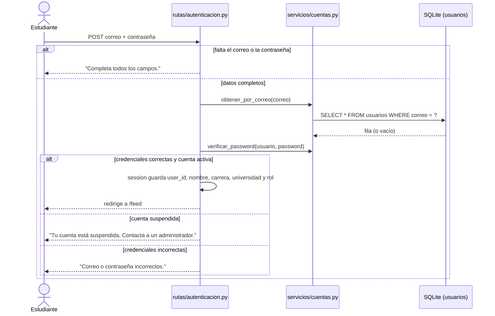
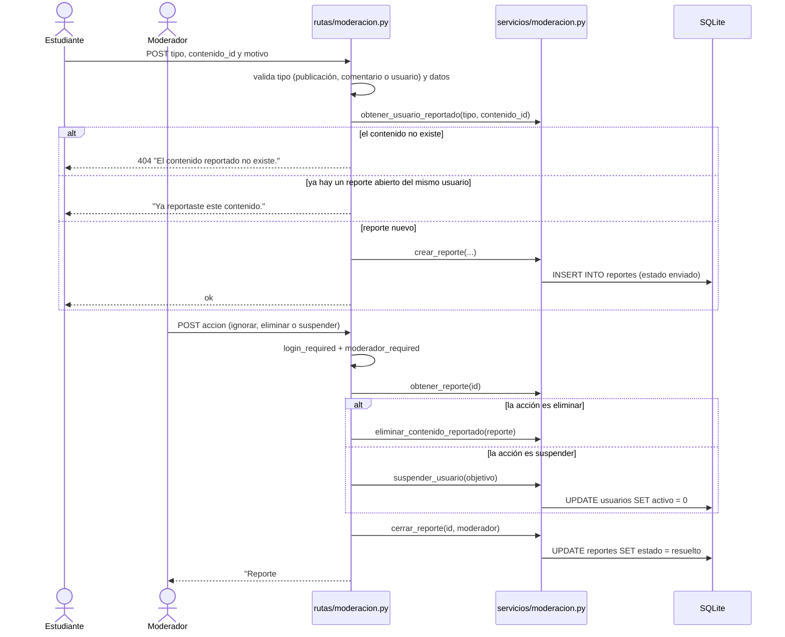
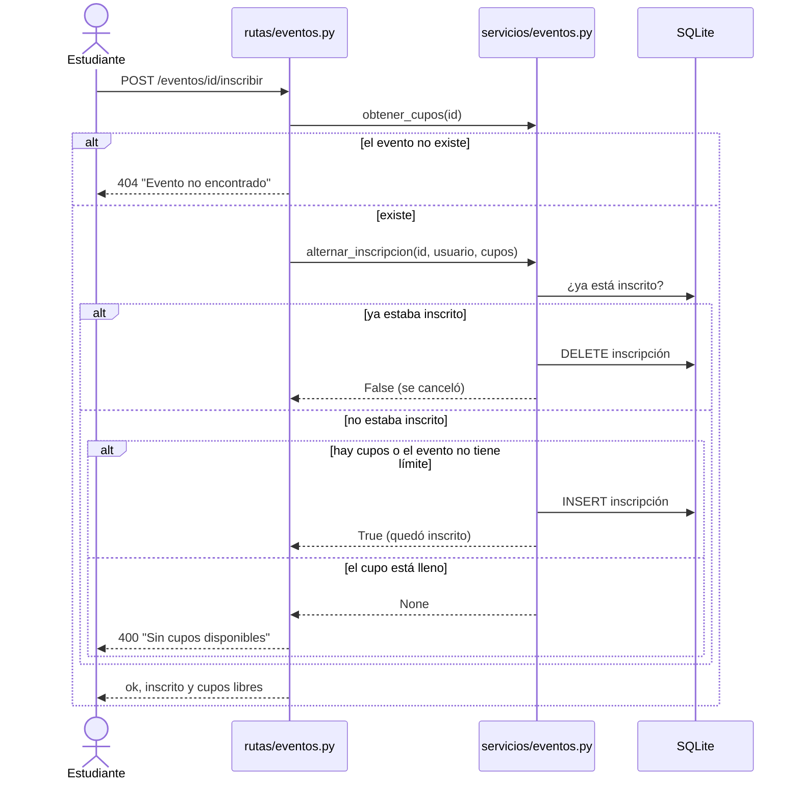
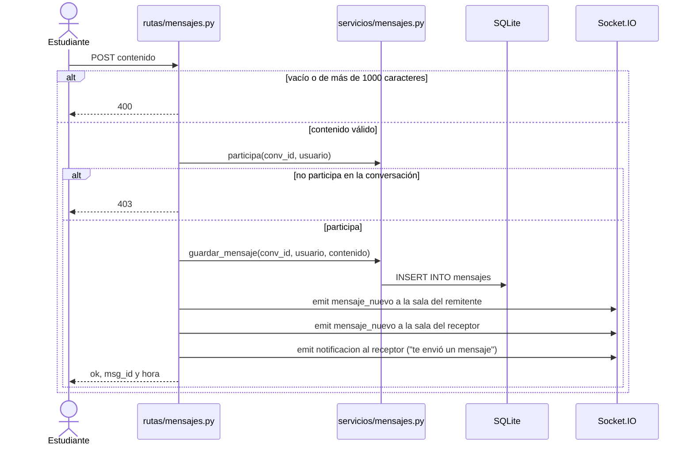

# Diagramas de secuencia

## Iniciar sesión (RF-02): `POST /login`

## Reportar y resolver un reporte (RF-32 y RF-35): `POST /reporte/nuevo` y `POST /moderacion/resolver/<id>`

Hoy ninguna pantalla llama a `/reporte/nuevo` (RF-32), pero el servicio funciona y tiene tests.

## Inscribirse a un evento (RF-30): `POST /eventos/<id>/inscribir`

## Enviar un mensaje privado (RF-44): `POST /mensajes/<conv_id>/enviar`

